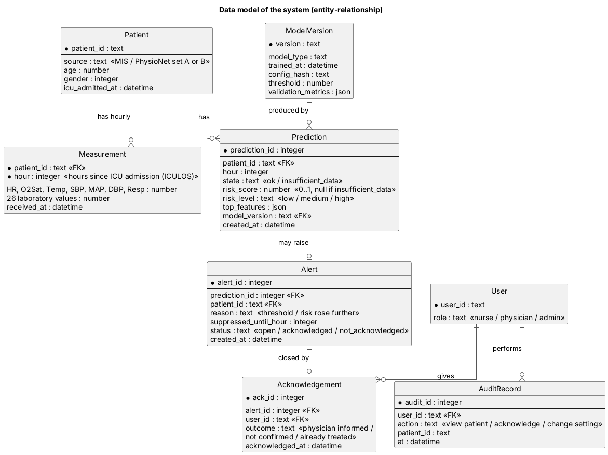
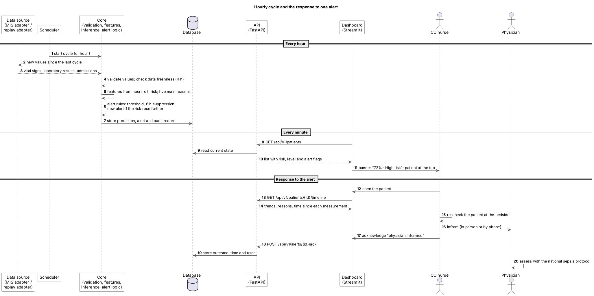

# Architecture Description

**Status:** draft, revised after the supervisor meeting of 23 Oct 2026 (DIP-13, DIP-27)  
**Last updated:** 23 Oct 2026  
**Related:** [target system and clinical workflow](target-system.md) · [requirements](../06-requirements.md) · [ML methodology](../05-technology/ml-methodology.md) · [technology comparison](../05-technology/technology-comparison.md) · [prototype](../08-prototype/)

## 1. Overview

The system is a **modular monolith in four layers**: a dashboard, a REST API, a core Python package with the data and model logic, and file/database storage. An **hourly cycle** takes new patient data through a **data-source interface** and runs them through the core; an **offline pipeline** (command line) uses the same core to import data, train models and evaluate them. How the system is used in an ICU, where the data come from and how alerts reach the staff are described in the [target system](target-system.md).

Why this structure:

- **One feature-building module for training and inference.** The API and the training pipeline call the same code, so the model sees features built exactly as in training (FR-02).
- **The dashboard contains no analytical logic.** It only calls the API, so all behaviour that matters can be tested through the API (NFR-04).
- **No extra infrastructure.** One backend and one client do not need message queues or separate services; this keeps the system runnable on one laptop (C-02, NFR-05).
- **The data source is replaceable.** In the diploma a replay adapter releases the PhysioNet files hour by hour; in a hospital an MIS adapter would take its place. Nothing behind the interface changes (FR-21).

Diagram sources are in [`diagrams/src`](../../diagrams/src) (PlantUML) and exports in [`diagrams/export`](../../diagrams/export).

## 2. System context

| Element | Role |
|---|---|
| ICU nurse | Primary user (AS-01, supported by the user evidence): sees the patient list, alerts and their reasons, re-checks the patient and acknowledges the alert. |
| ICU physician | Assesses alerted patients under the national sepsis protocol; reviews trends, reasons and acknowledgements. |
| Researcher / ML engineer | Secondary user: imports data, trains and evaluates models, reads reports, calls the API. |
| PhysioNet/CinC Challenge 2019 data | Data source in the diploma: downloaded once into `data/raw`, never committed, replayed hour by hour (FR-21). |
| Hospital MIS and bedside monitors | Target data source: designed in the [target system](target-system.md), not connected in the diploma (FR-17). |

## 3. Use cases

| ID | Use case | Actor | Main steps | Requirements |
|---|---|---|---|---|
| UC-01 | View patient list sorted by urgency | Nurse, physician | Open dashboard → unacknowledged and acknowledged alerts first, then the others by risk, each with a percentage and a coloured label | FR-08 |
| UC-02 | View patient trends and risk over time | Nurse, physician | Select a patient → see HR, Temp, Resp, MAP, O2Sat with the time since each measurement and the risk curve on one time axis | FR-09 |
| UC-03 | See why the risk is high (extends UC-02) | Nurse, physician | In the patient view, read the five measurements that contributed most | FR-10 |
| UC-04 | See alerts and data-quality warnings | Nurse | Banner and alert marker with the fixed prompt; "insufficient data" with a request to measure when vital signs are outdated | FR-07, FR-11, FR-19 |
| UC-10 | Acknowledge an alert with an outcome | Nurse | After re-checking the patient, choose: physician informed / change not confirmed / already being treated | FR-20 |
| UC-11 | Review alert history and acknowledgements | Physician | Open the patient's alerts with their outcomes and times | FR-20 |
| UC-05 | Import and validate patient data | Researcher | Run import or the replay → invalid files and values are reported with file, row and column | FR-01, FR-21 |
| UC-06 | Train baselines and main model (includes UC-05) | Researcher | Run `make train` with a configuration file → models and metadata are saved | FR-02, FR-03, FR-05 |
| UC-07 | Evaluate and compare models | Researcher | Run `make evaluate` → report; open the comparison view | FR-04, FR-13 |
| UC-08 | Configure threshold, suppression and data limit | Researcher | Change values in the configuration file → alert behaviour changes without code changes | FR-07, FR-11 |
| UC-09 | Request risk and model information via API | Researcher | Call `/api/v1/predict` or `/api/v1/models/current` | FR-06, FR-14 |

## 4. Components

| Component | Responsibility | Requirements | Technology |
|---|---|---|---|
| Patient list view | List patients by urgency: unacknowledged alerts, acknowledged alerts, the others by risk, insufficient data last; risk as a percentage with a coloured label | FR-08 | Streamlit |
| Patient detail view | Trends with time since measurement, risk curve, threshold, alerts, contributing measurements, fixed prompt, acknowledgement, disclaimer | FR-09, FR-10, FR-11, FR-19, FR-20, NFR-06, NFR-07 | Streamlit, Plotly |
| Model comparison view | Metrics and precision–recall curves for all models on both test sets | FR-13 | Streamlit, Plotly |
| Patients router | List patients, return a patient's measurement timeline and stored predictions | FR-08, FR-09, FR-12 | FastAPI |
| Prediction router | Validate the request, call the inference service, store the result | FR-06, FR-12, NFR-09 | FastAPI, Pydantic |
| Alerts router | Acknowledge an alert with an outcome; list alerts of a patient | FR-20, NFR-10 | FastAPI, Pydantic |
| Models router | Return metadata of the model in use and evaluation results | FR-13, FR-14 | FastAPI |
| Scheduler | Start the hourly cycle; mark alerts not acknowledged in time | FR-20, FR-21 | Python (APScheduler or a loop) |
| Data-source interface | One method: new values for the patients in the unit up to hour *t* | FR-21 | Python |
| Replay adapter | Implements the interface on PhysioNet files; never returns rows with ICULOS > *t* | FR-21, FR-02 | Python, pandas |
| MIS adapter (target, not built) | Would implement the interface on HL7 v2 messages or the MIS API | FR-17 (Won't) | — |
| Data validation | Check file schema, column names and value types | FR-01 | pandas |
| Feature builder | Forward fill within a patient, missingness features, rolling windows — only past data | FR-02 | pandas, NumPy |
| Inference service | Load the model, compute risk, call alert logic and explanation | FR-06, FR-10, FR-11 | scikit-learn, LightGBM |
| Alert logic | Threshold, suppression window, re-alert when the risk rises further, "insufficient data" state | FR-07, FR-11 | Python |
| Explanation | Top-5 signed feature contributions per prediction | FR-10 | SHAP |
| Ingestion | Read dataset files, run validation, load demo patients into the database | FR-01, FR-08 | Python CLI |
| Training | Build features, train partial SIRS, logistic regression and LightGBM, save model and metadata | FR-03, FR-05 | scikit-learn, LightGBM |
| Evaluation | Score internal and external test sets, bootstrap confidence intervals, write report | FR-04, FR-16 | scikit-learn, NumPy |
| SQLite | Patients, measurements, predictions, alerts, acknowledgements, audit records, model versions | FR-12, FR-14, FR-20, NFR-10 | SQLite, SQLAlchemy |
| Model store | Model files and metadata (version, seed, configuration hash, metrics) | FR-03, NFR-01 | joblib, JSON |
| Dataset files | Original PhysioNet files, outside Git | C-01, NFR-02 | PSV files |
| Evaluation reports | Metrics tables and curves produced by the evaluation | FR-04 | JSON, Markdown, PNG |

## 5. Data

The data model has eight entities. A **Patient** has one **Measurement** row per ICU hour, in the same shape as the PhysioNet files: the vital signs and 26 laboratory values recorded in that hour, empty where nothing was measured. Every hourly cycle writes a **Prediction** for each patient: the state (`ok` or `insufficient_data`), the risk and its level, the five main reasons and the **ModelVersion** that produced it. A prediction that passes the alert rules raises an **Alert**; the alert keeps its reason (threshold or a further rise), the hour until which repeats are suppressed and its status. The nurse closes it with an **Acknowledgement** that stores the outcome, the **User** and the time. Every view of a patient, acknowledgement and change of a setting leaves an **AuditRecord** (NFR-10).

In the diploma these tables live in SQLite; in the target hospital in PostgreSQL (target system §6.1). The PhysioNet files and the evaluation reports stay files. Demo patients are taken from the test sets only, so the dashboard never shows a patient the model was trained on.

## 6. Key scenarios

### 6.1 Hourly cycle and the response to an alert (UC-01 – UC-04, UC-10)

1. The scheduler starts the cycle for hour *t*; the core asks the data-source interface for new values (replay adapter in the diploma).
2. The core validates the values, checks data freshness, builds features from hours ≤ *t*, computes the risk and the five main reasons, and applies the alert rules.
3. The prediction, any alert and an audit record are stored.
4. The dashboard asks the API for the patient list every minute; a new alert appears at the top with a banner.
5. The nurse opens the patient (trends, reasons, time since each measurement), re-checks the patient at the bedside and acknowledges the alert with an outcome through `POST /api/v1/alerts/{id}/ack`.

The clinical steps around this sequence — who does what before and after the alert — are in the [target system](target-system.md) §5 and its workflow diagram.

### 6.2 Researcher asks for a risk on demand (UC-09)

`POST /api/v1/predict` with a patient history up to hour *t* runs the same core steps as the hourly cycle and returns the result with the disclaimer. It is used for tests and by external callers; the dashboard reads stored predictions.

### 6.3 Researcher trains and evaluates (UC-05 – UC-07)

1. `make train`: ingestion validates the files → training builds features on the training split → models and metadata are saved to the model store.
2. `make evaluate`: evaluation uses the inference service on the internal and external test sets → metrics with confidence intervals are written to the reports folder.
3. The models router serves the latest evaluation results to the comparison view.

## 7. Architectural decisions

| Decision | Choice | Reason | Record |
|---|---|---|---|
| Project direction | Early sepsis-risk prediction on PhysioNet 2019 | Open data with a defined label; substantial time-series engineering | [ADR-001](../decisions/ADR-001-scope.md) |
| Component interaction | REST over HTTP with JSON, described by OpenAPI | One client and one backend; simple to test and document | [technology comparison](../05-technology/technology-comparison.md) |
| Backend | FastAPI | Typed request validation, automatic OpenAPI, Python ML in the same process | technology comparison |
| Storage | SQLite for application data; files for the dataset and models | No server needed; enough for a single-user prototype | technology comparison |
| Dashboard | Streamlit as an API client | Fast to build; analytical logic stays in the backend | technology comparison |
| Shared feature code | One module used by training and inference | Prevents training/serving differences | this document, §1 |
| Data entry | A data-source interface with a replay adapter (diploma) and an MIS adapter (target) | The same system runs on open data and in a hospital; future rows can never leak into the past | [target system](target-system.md) §3 |
| Alert delivery | Patient list and banner at the nurse station; acknowledgement with an outcome | Fits the existing nurse-first escalation; makes false alerts measurable | [target system](target-system.md) §5 |

## 8. Mapping to the repository

| Folder | Content |
|---|---|
| `src/ml/` | Core package: validation, feature builder, models, inference, alert logic, explanation, training and evaluation entry points |
| `src/backend/` | FastAPI application and routers |
| `src/frontend/` | Streamlit dashboard |
| `config/` | Configuration files (seed, features, hyper-parameters, threshold, suppression window) |
| `tests/` | Unit, integration and API tests |
| `evaluation/` | Evaluation scripts and committed summary results (raw outputs ignored) |
| `diagrams/` | PlantUML sources and PNG exports |
| `data/` | Local data only; `raw/` and `processed/` are ignored by Git |

## 9. Open points

- The dashboard reads stored predictions written by the hourly cycle (decided on 23 Oct 2026); the prediction endpoint stays for tests and external callers.
- The 30-minute limit for unacknowledged alerts and the 0.10 re-alert margin are first values; they are checked in the next user discussions ([target system](target-system.md) §8).
- All diagrams: [system context](../../diagrams/export/system-context.png), [use cases](../../diagrams/export/use-case.png), [components](../../diagrams/export/component.png), [data model](../../diagrams/export/data-model.png), [alert sequence](../../diagrams/export/alert-sequence.png), [clinical workflow](../../diagrams/export/clinical-workflow.png), [deployment](../../diagrams/export/deployment.png).
