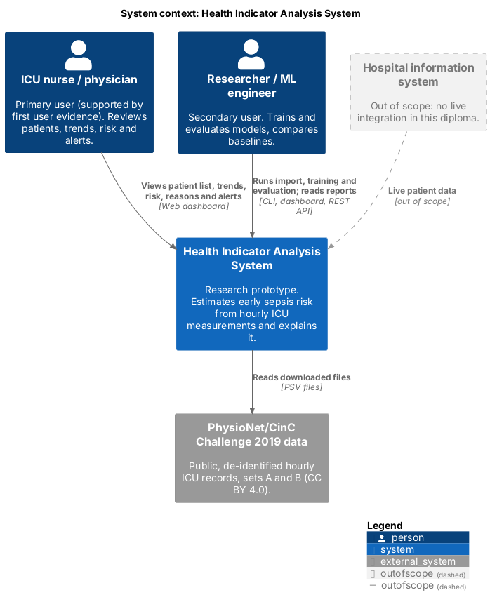
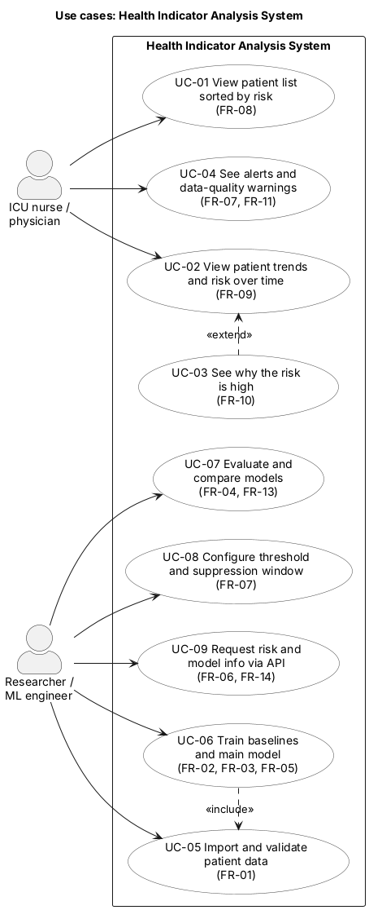
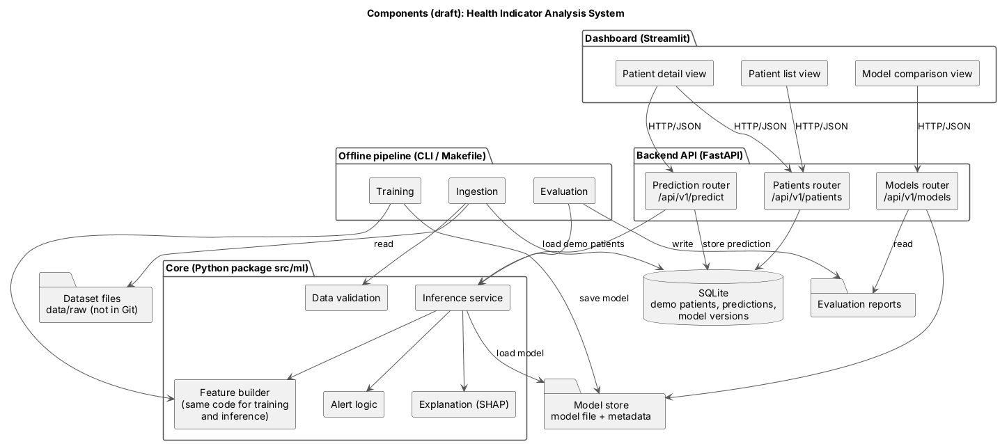

# Architecture Description

**Status:** draft for supervisor review (DIP-13)  
**Last updated:** 21 Oct 2026  
**Related:** [requirements](../06-requirements.md) · [ML methodology](../05-technology/ml-methodology.md) · [technology comparison](../05-technology/technology-comparison.md) · [prototype](../08-prototype/)

## 1. Overview

The system is a **modular monolith in four layers**: a dashboard, a REST API, a core Python package with the data and model logic, and file/database storage. An **offline pipeline** (command line) uses the same core package to import data, train models and evaluate them.

Why this structure:

- **One feature-building module for training and inference.** The API and the training pipeline call the same code, so the model sees features built exactly as in training (FR-02).
- **The dashboard contains no analytical logic.** It only calls the API, so all behaviour that matters can be tested through the API (NFR-04).
- **No extra infrastructure.** One backend and one client do not need message queues or separate services; this keeps the system runnable on one laptop (C-02, NFR-05).

Diagram sources are in [`diagrams/src`](../../diagrams/src) (PlantUML) and exports in [`diagrams/export`](../../diagrams/export).

## 2. System context

| Element | Role |
|---|---|
| ICU nurse / physician | Primary user (AS-01, supported by the first user evidence): reviews the patient list, trends, risk, reasons and alerts in the dashboard. |
| Researcher / ML engineer | Secondary user: imports data, trains and evaluates models, reads reports, calls the API. |
| PhysioNet/CinC Challenge 2019 data | External data source: downloaded once into `data/raw`, never committed. |
| Hospital information system | Shown only to mark the boundary: live integration is out of scope (FR-17). |

## 3. Use cases

| ID | Use case | Actor | Main steps | Requirements |
|---|---|---|---|---|
| UC-01 | View patient list sorted by risk | Clinician | Open dashboard → see demo patients with an active alert first, then the others by current risk | FR-08 |
| UC-02 | View patient trends and risk over time | Clinician | Select a patient → see HR, Temp, Resp, MAP, O2Sat and the risk curve on one time axis | FR-09 |
| UC-03 | See why the risk is high (extends UC-02) | Clinician | In the patient view, read the five measurements that contributed most | FR-10 |
| UC-04 | See alerts and data-quality warnings | Clinician | Alert hours are marked; "insufficient data" is shown instead of a risk when vital signs are outdated | FR-07, FR-11 |
| UC-05 | Import and validate patient data | Researcher | Run import → invalid files are reported with file, row and column | FR-01 |
| UC-06 | Train baselines and main model (includes UC-05) | Researcher | Run `make train` with a configuration file → models and metadata are saved | FR-02, FR-03, FR-05 |
| UC-07 | Evaluate and compare models | Researcher | Run `make evaluate` → report; open the comparison view | FR-04, FR-13 |
| UC-08 | Configure threshold and suppression window | Researcher | Change values in the configuration file → alert behaviour changes without code changes | FR-07 |
| UC-09 | Request risk and model information via API | Researcher | Call `/api/v1/predict` or `/api/v1/models/current` | FR-06, FR-14 |

## 4. Components

| Component | Responsibility | Requirements | Technology |
|---|---|---|---|
| Patient list view | List demo patients: active alerts first, then by current risk | FR-08 | Streamlit |
| Patient detail view | Trends, risk curve, threshold, alerts, contributing measurements, disclaimer | FR-09, FR-10, FR-11, NFR-06, NFR-07 | Streamlit, Plotly |
| Model comparison view | Metrics and precision–recall curves for all models on both test sets | FR-13 | Streamlit, Plotly |
| Patients router | List patients, return a patient's measurement timeline and stored predictions | FR-08, FR-09, FR-12 | FastAPI |
| Prediction router | Validate the request, call the inference service, store the result | FR-06, FR-12, NFR-09 | FastAPI, Pydantic |
| Models router | Return metadata of the model in use and evaluation results | FR-13, FR-14 | FastAPI |
| Data validation | Check file schema, column names and value types | FR-01 | pandas |
| Feature builder | Forward fill within a patient, missingness features, rolling windows — only past data | FR-02 | pandas, NumPy |
| Inference service | Load the model, compute risk, call alert logic and explanation | FR-06, FR-10, FR-11 | scikit-learn, LightGBM |
| Alert logic | Threshold, suppression window, "insufficient data" state | FR-07, FR-11 | Python |
| Explanation | Top-5 signed feature contributions per prediction | FR-10 | SHAP |
| Ingestion | Read dataset files, run validation, load demo patients into the database | FR-01, FR-08 | Python CLI |
| Training | Build features, train partial SIRS, logistic regression and LightGBM, save model and metadata | FR-03, FR-05 | scikit-learn, LightGBM |
| Evaluation | Score internal and external test sets, bootstrap confidence intervals, write report | FR-04, FR-16 | scikit-learn, NumPy |
| SQLite | Demo patients, stored predictions, model versions | FR-12, FR-14 | SQLite, SQLAlchemy |
| Model store | Model files and metadata (version, seed, configuration hash, metrics) | FR-03, NFR-01 | joblib, JSON |
| Dataset files | Original PhysioNet files, outside Git | C-01, NFR-02 | PSV files |
| Evaluation reports | Metrics tables and curves produced by the evaluation | FR-04 | JSON, Markdown, PNG |

## 5. Data

| Entity | Main fields | Where it lives |
|---|---|---|
| Patient-hour record | patient ID, ICU hour (`ICULOS`), 40 variables, `SepsisLabel` | Dataset files (raw); demo subset in SQLite |
| Prediction | patient ID, ICU hour, risk score, risk level, alert flag, data-quality state, model version, created at | SQLite |
| Model version | version, model type, training date, configuration hash, threshold, validation metrics | Model store (metadata file) and SQLite |
| Evaluation result | model, test set, metric, value, 95% CI | Evaluation reports |

Demo patients for the dashboard are taken from the test sets only, so the dashboard never shows a patient the model was trained on.

## 6. Key scenarios

### 6.1 Clinician opens a patient (UC-02, UC-03, UC-04)

1. The patient detail view requests the patient's timeline from the patients router.
2. It sends the history up to the selected hour to `POST /api/v1/predict`.
3. The prediction router validates the request and calls the inference service.
4. The inference service builds features with the feature builder, loads the model, computes the risk, applies the alert logic and asks the explanation component for the top-5 contributions.
5. The router stores the prediction in SQLite and returns the result with the disclaimer.
6. The view draws the trends, the risk curve, alerts and the contributing measurements.

### 6.2 Researcher trains and evaluates (UC-05 – UC-07)

1. `make train`: ingestion validates the files → training builds features on the training split → models and metadata are saved to the model store.
2. `make evaluate`: evaluation uses the inference service on the internal and external test sets → metrics with confidence intervals are written to the reports folder.
3. The models router serves the latest evaluation results to the comparison view.

## 7. Architectural decisions

| Decision | Choice | Reason | Record |
|---|---|---|---|
| Project direction | Early sepsis-risk prediction on PhysioNet 2019 | Open data with a defined label; substantial time-series engineering | [ADR-001](../decisions/ADR-001-scope.md) |
| Component interaction | REST over HTTP with JSON, described by OpenAPI | One client and one backend; simple to test and document | [technology comparison](../05-technology/technology-comparison.md) |
| Backend | FastAPI | Typed request validation, automatic OpenAPI, Python ML in the same process | technology comparison |
| Storage | SQLite for application data; files for the dataset and models | No server needed; enough for a single-user prototype | technology comparison |
| Dashboard | Streamlit as an API client | Fast to build; analytical logic stays in the backend | technology comparison |
| Shared feature code | One module used by training and inference | Prevents training/serving differences | this document, §1 |

## 8. Mapping to the repository

| Folder | Content |
|---|---|
| `src/ml/` | Core package: validation, feature builder, models, inference, alert logic, explanation, training and evaluation entry points |
| `src/backend/` | FastAPI application and routers |
| `src/frontend/` | Streamlit dashboard |
| `config/` | Configuration files (seed, features, hyper-parameters, threshold, suppression window) |
| `tests/` | Unit, integration and API tests |
| `evaluation/` | Evaluation scripts and committed summary results (raw outputs ignored) |
| `diagrams/` | PlantUML sources and PNG exports |
| `data/` | Local data only; `raw/` and `processed/` are ignored by Git |

## 9. Open points

- Whether the dashboard should call the prediction endpoint for every hour of a stay or read stored predictions will be decided when the first version runs (performance, NFR-03).
- Sequence diagrams for scenarios 6.1 and 6.2 can be added for the next pre-defense.
