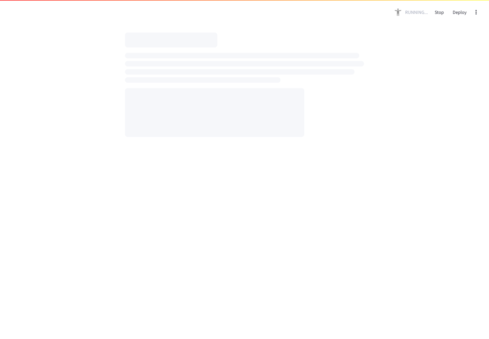
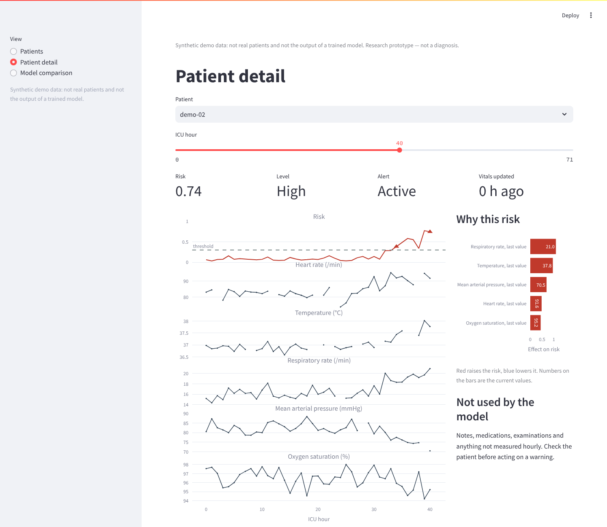
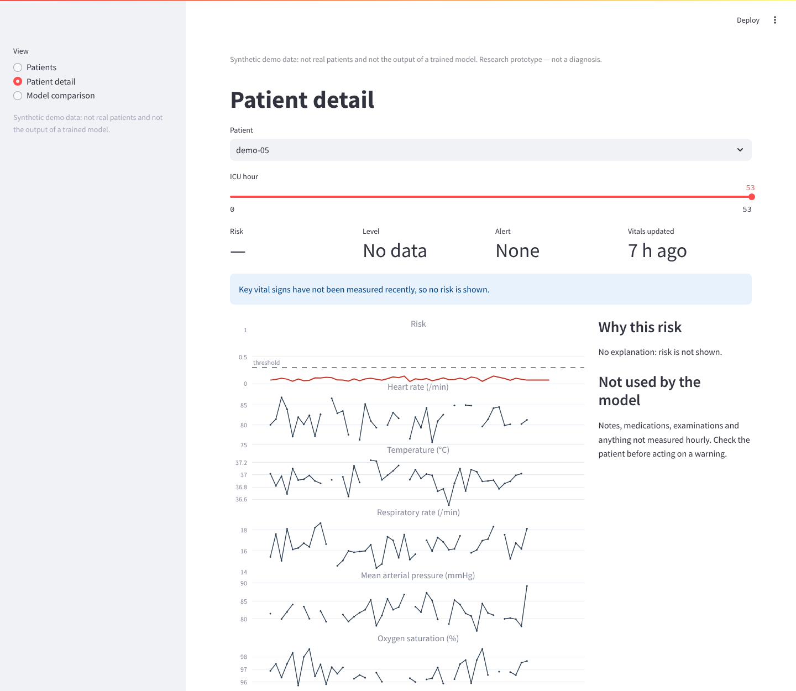
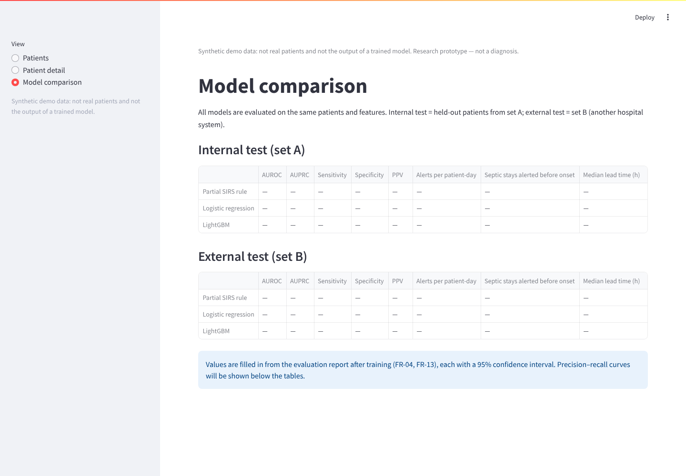

# UX Prototype

**Status:** first version (DIP-14)  
**Last updated:** 21 Oct 2026  
**Related:** [requirements](../06-requirements.md) · [architecture](../07-architecture/architecture.md) · [API examples](api-examples.md)

The prototype is a clickable dashboard built with the same technology as the planned system (Streamlit + Plotly). It runs on **synthetic data**: generated vital signs and a hand-written risk formula stand in for real patients and the trained model. The goal is to show how a user will interact with the system and to collect feedback before the real pipeline exists.

## How to run

```
pip install -r requirements.txt
streamlit run src/frontend/prototype_app.py
```

Code: [`src/frontend/prototype_app.py`](../../src/frontend/prototype_app.py) (screens) and [`src/frontend/demo_data.py`](../../src/frontend/demo_data.py) (synthetic data and the alert rules).

## Key screens

### 1. Patient list — UC-01 (FR-08)



Patients with an active alert come first, then the rest by risk. A patient whose vital signs are too old shows "Insufficient data" instead of a number. The caption states the alert rules in use.

### 2. Patient detail at the first alert — UC-02, UC-03, UC-04 (FR-07, FR-09, FR-10)



One time axis for the risk and five vital signs, so the user sees *what changed* together with the risk. The threshold is drawn; triangles mark alerts (repeated alerts within 6 h are suppressed). The time slider replays the stay hour by hour. The right panel shows which measurements raised or lowered the risk and reminds the user what the model does not see.

### 3. Insufficient data — UC-04 (FR-11)



When key vital signs have not been measured for more than 4 hours, no risk is shown and no alert can fire. This follows the idea of an "indeterminate" output from COMPOSER (literature #7): it is better to say "I don't know" than to show a confident number built on stale data.

### 4. Model comparison — UC-07 (FR-13)



The same metrics for the partial SIRS rule, logistic regression and LightGBM, on the internal test (set A) and the external test (set B). The cells stay empty until the evaluation report exists; no example numbers are shown, to avoid presenting invented results.

## Design decisions and where they come from

| Decision | Reason | Source |
|---|---|---|
| Risk shown together with trends, not alone | A number without context is hard to trust or act on | AS-03, AS-05; literature #10 |
| Top contributing measurements next to the risk | Users need to see why a warning appears | AS-03; literature #7, #10 |
| Suppression of repeated alerts | Alert fatigue reduces usefulness | AS-04; literature #6, #10 |
| "Insufficient data" state | Avoids confident output on stale data | literature #7 |
| Disclaimer on every screen | The system is decision support, not a diagnosis | C-04, NFR-06 |
| Patients with an alert listed first | The first question on a shift is "whom do I check first?" | AS-01; both respondents chose a list sorted by risk (EV-08); the alert-first order itself is not yet tested |

## What is synthetic and what changes later

| In the prototype | In the real system |
|---|---|
| Generated vital signs for 8 demo patients | Demo patients taken from the test sets of the PhysioNet data |
| Hand-written risk formula | LightGBM model trained as described in the ML methodology |
| Contributions from the same formula | SHAP values of the trained model |
| Insufficient-data rule over the 5 simulated vital signs (SBP is not simulated) | Rule over the six key vital signs of FR-11 |
| Threshold 0.30, suppression 6 h, data limit 4 h | Threshold chosen on validation data; limits set from the data analysis; all in the configuration file |
| Data computed inside the dashboard | Dashboard calls the backend API (see [API examples](api-examples.md)) |

## Known gap

NFR-07 requires risk, trends and contributing measurements to be visible without scrolling at 1366×768. The prototype does not meet this yet: at that size the patient view is about 1,450 px high (the chart alone is 760 px), so only the risk and the first vital sign are visible without scrolling. The real dashboard must meet the criterion; the layout will be compacted when it is built (M3).

## Planned user check

The screens will be shown to 2–3 of the respondents from the user discussions (DIP-4). Questions:

1. Looking at screen 2, why is the risk high for this patient?
2. What would you do next?
3. What is missing or confusing on this screen?

The answers check NFR-07 and feed back into the requirements.
